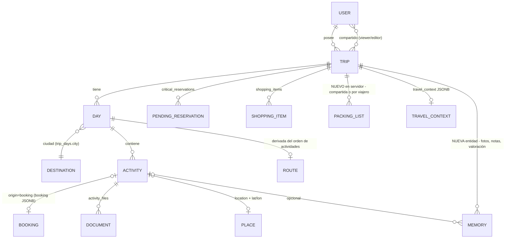
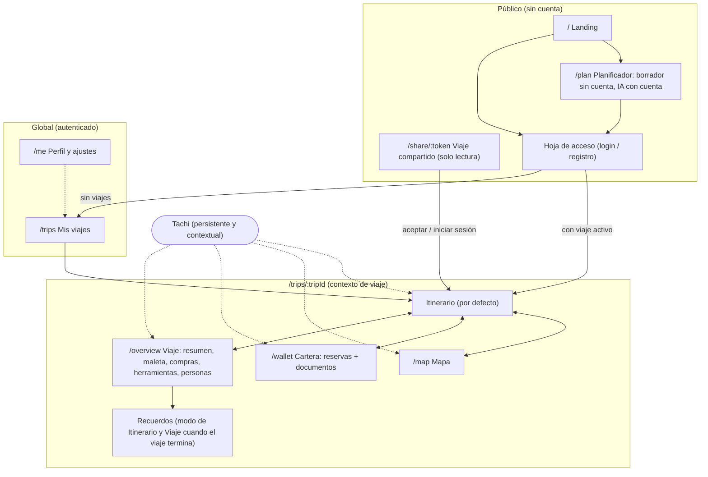
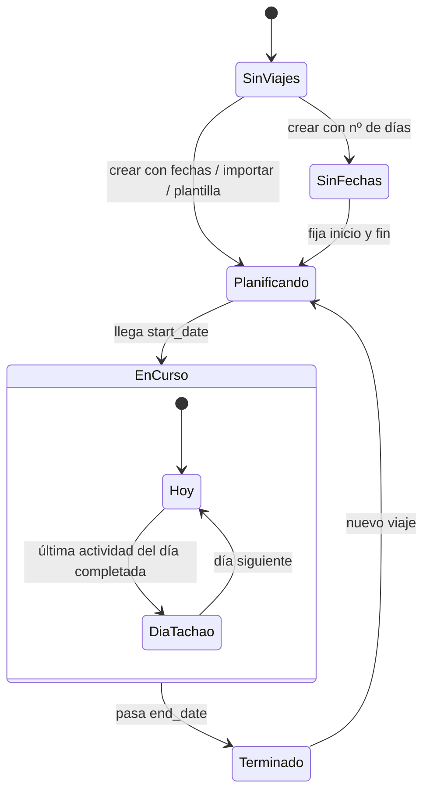

# 03 · Arquitectura de información

**Decisión:** dos niveles de navegación. **Global** (Mis viajes, Perfil) arriba y fuera del viaje; **dentro del viaje**, cuatro secciones: **Itinerario · Mapa · Cartera · Viaje**. Tachi es un botón persistente y contextual, no una sección.

---

## 1. Modelo conceptual



| Entidad | Existe como dato | Nota |
|---------|------------------|------|
| Usuario | ✅ Supabase Auth (incluye anónimo) | |
| Viaje | ✅ `trips` | Entidad central. |
| Destino | 🟡 `trip_days.city` | Se deriva; no hace falta tabla para esta reestructuración. |
| Día | ✅ `trip_days` | |
| Actividad | ✅ `activities` | |
| Reserva | ✅ `activities.booking` + `critical_reservations` | Vista unificada en Cartera. |
| Documento | ✅ `activity_files` | Siempre colgado de una actividad. |
| Lugar | 🟡 `location`, `lat`, `lon` | Sin "lugares guardados". |
| Ruta | 🟡 derivada (`buildRouteLegs`) | Línea recta estimada, no ruteo real. |
| Recuerdo | 💭 | **Decidido: entidad nueva** (Fase 5), no se mezcla con `activity_files`. |

---

## 2. Mapa del sitio propuesto



### Rutas (propuesta compatible con App Router de Next 16)

| URL | Pantalla | Reemplaza a |
|-----|----------|-------------|
| `/` | Landing (visitante) · redirección al viaje activo (autenticado) | `app/page.tsx` |
| `/plan` | Planificador del primer viaje (formulario público; generar con IA exige cuenta) | Nuevo; reutiliza `api/import` (planning) |
| `/trips` | Mis viajes | Nuevo; hoy `/trips` = itinerario |
| `/trips/[tripId]` | Itinerario | `app/trips/page.tsx` → `TripView` |
| `/trips/[tripId]/map` | Mapa | Overlay/sidebar de `DayMapView` |
| `/trips/[tripId]/wallet` | Cartera | `CriticalReservationsPanel` + adjuntos dispersos |
| `/trips/[tripId]/overview` | Viaje | Sidebar (presupuesto, compras, herramientas, maleta, contexto) |
| `/me` | Perfil y ajustes | Botones de tema/idioma/logout en cabecera |
| `/share/[token]` | Compartido | Se mantiene |

Notas técnicas verificadas en `node_modules/next/dist/docs`:

- Usar un **route group** `(app)` con un layout de shell para `/trips/**` y `/me`, y dejar `/`, `/plan` y `/share` fuera. **No** crear varios root layouts: navegar entre root layouts distintos provoca recarga completa.
- **Decidido: rutas anidadas** por viaje y sección.
- En Next 16 `params` es una `Promise` (`const { tripId } = await params`).
- `middleware` está deprecado y renombrado a `proxy.ts`; si se mueve la redirección inicial al servidor, va ahí. Hoy la sesión vive en el cliente (Supabase JS), así que se mantiene la redirección en cliente; moverla a `proxy.ts` queda como TODO a evaluar tras la Fase 2.
- Query `?day=YYYY-MM-DD` en Itinerario y Mapa para enlazar un día concreto. `?doc=<fileId>` en Cartera para abrir un documento directamente.

---

## 3. Navegación global vs. contextual

| Nivel | Elementos | Dónde aparece |
|-------|-----------|---------------|
| **Global** | Mis viajes, Perfil/ajustes (cuenta, idioma, tema, tour, cerrar sesión) | Selector de viaje (título en cabecera) y avatar |
| **Viaje** | Itinerario, Mapa, Cartera, Viaje | Bottom nav (móvil) / tabs en cabecera (desktop) |
| **Día** | Tira de días, Añadir, Tachi (reorganizar el día), filtro de mapa | Barra de día (ya existe) |
| **Actividad** | Detalle, reserva, documentos, ver en mapa, comentarios, completar | Hoja de actividad |
| **IA** | Tachi | Botón persistente + atajos contextuales |

Regla: **nada global en la bottom nav, nada del viaje en el menú de perfil.**

### Por qué "Mis viajes" NO va en la bottom nav

| Alternativa | Ventaja | Inconveniente |
|-------------|---------|---------------|
| A. Mis viajes como 5ª pestaña | Siempre visible | Mezcla global con viaje; ocupa un hueco que se usa poco durante el viaje. |
| **B. Mis viajes desde el título del viaje en la cabecera (recomendada)** | Mantiene el `TripSwitcher` actual como patrón; la bottom nav es 100 % del viaje | Un toque más para cambiar de viaje (aceptable: se cambia poco). |
| C. Drawer lateral global | Cabe todo | Navegación oculta; peor descubribilidad en móvil. |

---

## 4. Navegación móvil

```text
┌─────────────────────────────────┐
│ [Kioto · 12–20 nov ▾]   (👤)    │  ← cabecera: selector de viaje (global) + avatar
│ L12 M13 [X14] J15 V16 S17 ...   │  ← tira de días (solo en Itinerario y Mapa)
├─────────────────────────────────┤
│                                 │
│        contenido de sección     │
│                                 │
│                          (✦)    │  ← Tachi persistente (sustituye al ChatFab)
├─────────────────────────────────┤
│ Itinerario  Mapa  Cartera  Viaje│  ← bottom nav (4 ítems, 44 px+)
└─────────────────────────────────┘
```

| Patrón | Uso en Tachao | Decisión |
|--------|---------------|----------|
| Bottom navigation | 4 secciones del viaje | ✅ Sí |
| Tabs secundarias | Dentro de Cartera (Reservas / Documentos) y Viaje (Resumen / Maleta / Compras / Herramientas) | ✅ Sí, segmentadas arriba |
| Drawers | — | ❌ No; esconden navegación |
| Bottom sheets | Detalle de actividad, Tachi, añadir actividad, documento | ✅ Sí; patrón principal contextual |
| FAB "+" | Añadir actividad en Itinerario | ✅ Se mantiene, solo en Itinerario |
| Botón IA persistente | Tachi | ✅ Sí, encima de la bottom nav; su menú cambia según la sección |

Para un **invitado viewer**, la bottom nav es la misma y **todas las secciones son visibles en solo lectura** (incluido el Mapa), para que vea las funcionalidades; las acciones de edición se ocultan. Un **borrador sin cuenta** se ve y se **edita** en todas las secciones; solo guardar (y la IA) piden iniciar sesión.

---

## 5. Navegación desktop (≥ `lg`)

- Cabecera: selector de viaje · tabs **Itinerario / Mapa / Cartera / Viaje** · Tachi · avatar.
- Itinerario mantiene el layout de dos columnas actual, pero el **panel derecho pasa a ser contextual**: mapa del día por defecto (ya existe la vista `1fr_1fr`), o detalle de la actividad seleccionada. Las tarjetas que hoy viven en el sidebar se mudan a **Viaje** y **Cartera**.
- El panel de Tachi se abre como panel lateral derecho (no modal centrado), para que el día siga visible al revisar cambios.

---

## 6. Comportamiento según los viajes del usuario

La lógica de selección ya existe (`lib/trip-selection.ts`). Desde la Fase 2 la regla es: en curso (el favorito si hay varios) → favorito → próximo más cercano → último pasado.

| Situación | Pantalla inicial | Qué cambia |
|-----------|------------------|------------|
| Sin viajes | `/trips` vacío con planificador (Tachi) y plantillas | Hoy redirige a la landing; pasa a ser un estado vacío propio del área privada. |
| 1 viaje en planificación | `/trips/:id` Itinerario en modo **Planificando** | Banner de preparación (reservas pendientes, días sin plan). Si no tiene fechas, los días se muestran como "Día 1, Día 2…" y el banner invita a fijar fechas. |
| Varios viajes próximos | El más cercano (o favorito) | Cabecera muestra "+2 viajes" junto al selector. |
| Viaje en curso | Itinerario en modo **Hoy**, día de hoy seleccionado y "próxima actividad" fijada arriba | Cartera muestra primero las reservas de hoy. |
| Solo viajes terminados | Último viaje en modo **Recuerdo** | Invitación a planificar el siguiente. |
| Viaje en curso + próximos | Siempre el en curso | Los próximos solo en Mis viajes. |



---

## 7. Relación entre pantallas (acciones contextuales clave)

| Desde | Acción | Destino | Sin salir del itinerario |
|-------|--------|---------|--------------------------|
| Actividad | Ver reserva | Hoja de actividad › bloque Reserva | ✅ |
| Actividad | Abrir documento | `DocumentViewer` a pantalla completa | ✅ (cerrar vuelve al día) |
| Actividad | Ver en mapa | Mapa con `?day=` y actividad seleccionada | ↔ cambia de pestaña, conserva día |
| Barra del día | Tachi | Hoja de Tachi con el día como contexto | ✅ |
| Tachi | Añadir sugerencia | Actividad nueva en el día | ✅ |
| Cartera › reserva | Ir a la actividad | Itinerario en ese día, actividad resaltada | ↔ |
| Cartera › documento | Abrir | `DocumentViewer` | ✅ |
| Viaje › reserva pendiente | Marcar reservada | — | ✅ |
| Mis viajes | Abrir viaje | Itinerario de ese viaje | ↔ |
