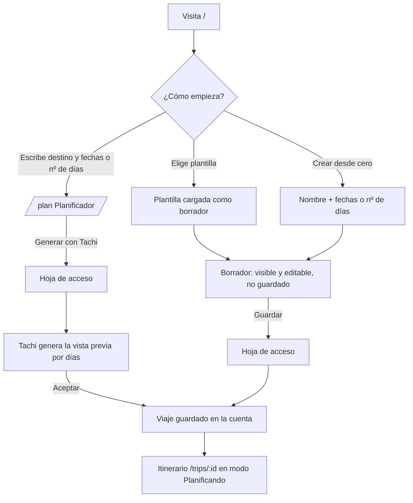
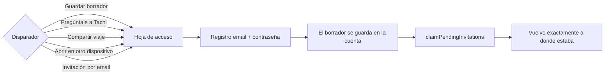
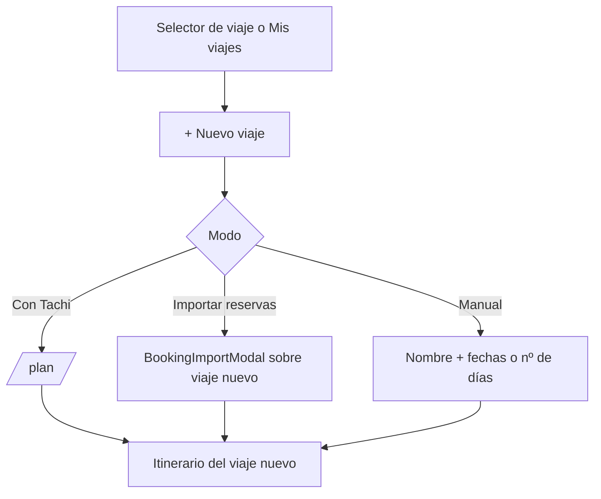
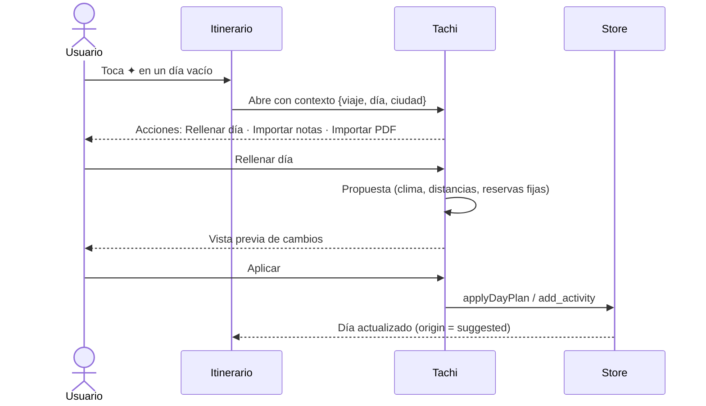
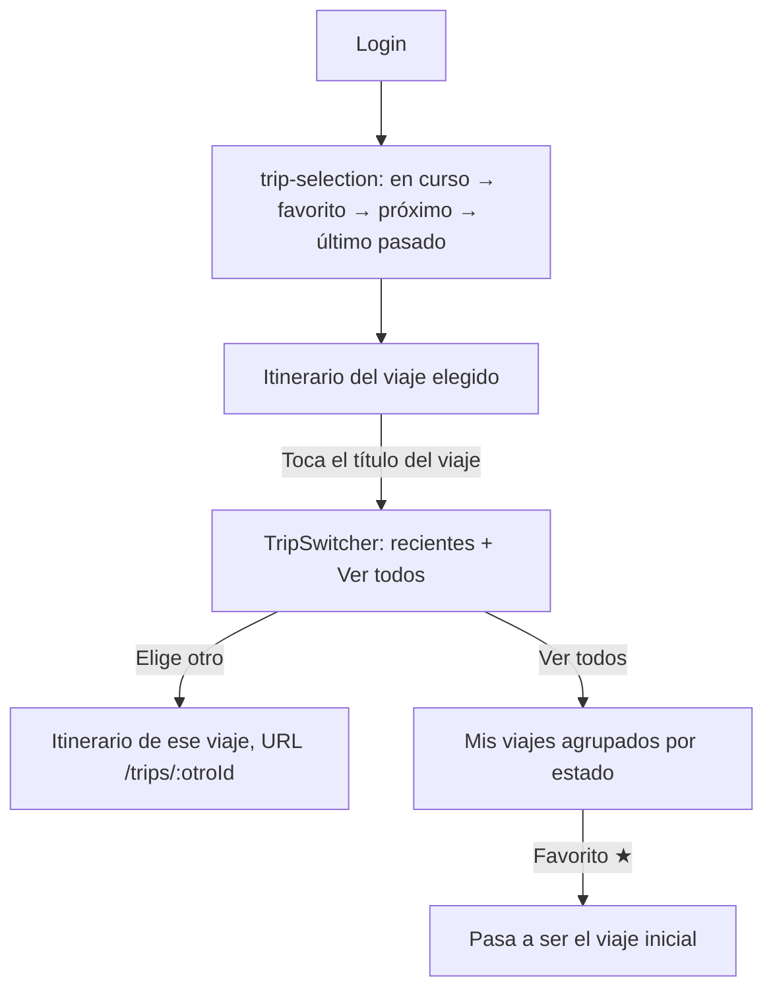
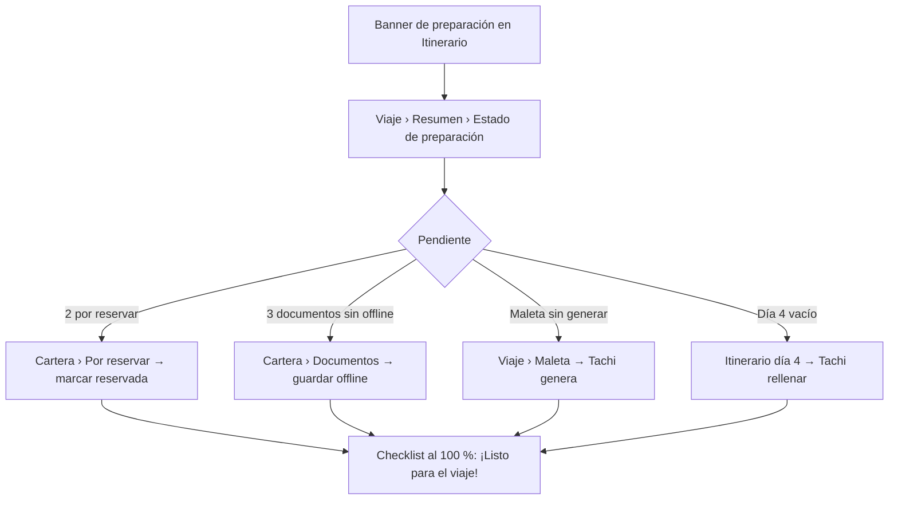
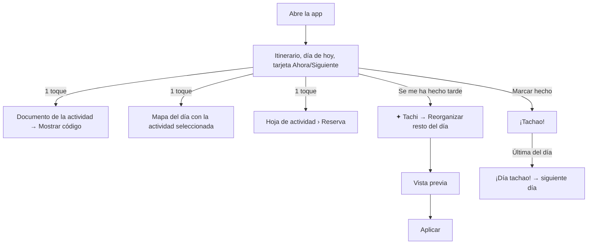
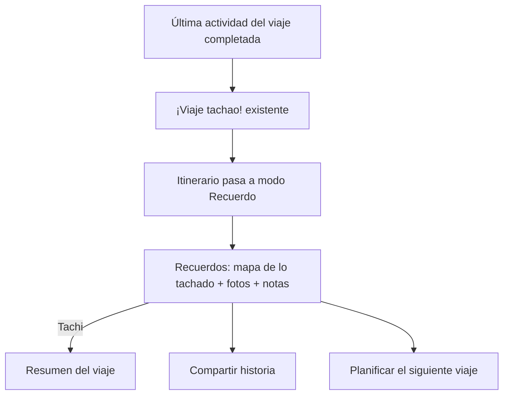

# 05 · Flujos de usuario

**Regla común a todos los flujos:** el visitante puede explorar y preparar un borrador antes de que se le pida cuenta; guardar y usar a Tachi (IA) requieren registro; y una vez dentro de un viaje llega a cualquier dato en ≤ 2 toques desde el Itinerario.

---

## F1 · Usuario nuevo → primer viaje (borrador, guardado con cuenta)

Notas:

- **Decidido:** se mantiene el modelo de borrador que exige login para guardarse (como las plantillas hoy, `activeTripIsDraft`) y se extiende a "Crear desde cero", que hoy guarda directamente en la sesión anónima.
- **Decidido:** la IA solo está disponible con cuenta; "Generar con Tachi" lleva al registro y conserva lo rellenado.

## F2 · Registro

Requisito: tras registrarse, **volver a la misma pantalla** (hoy `AuthInitializer` puede redirigir a `/trips`). El copy de la hoja explica el motivo del disparador.

## F3 · Creación de viaje (autenticado)

## F4 · Planificación con IA dentro del viaje

## F5 · Gestión de varios viajes

## F6 · Preparación del viaje

## F7 · Uso durante el viaje (modo Hoy)

Objetivo medible: tarjeta de embarque en ≤ 2 toques desde la apertura (Cartera › Hoy › documento, o tarjeta Ahora › documento).

## F8 · Finalización y recuerdos

F8 depende de la Fase 5 (modelo de recuerdos). Hasta entonces, el modo Recuerdo muestra solo completadas y mapa.
