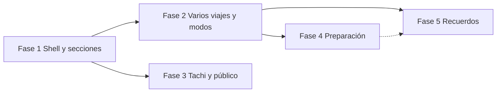

# 07 · Roadmap de implementación

**Orden recomendado:** primero la estructura (shell + secciones del viaje con URL), después la gestión de varios viajes y los modos del itinerario, y en tercer lugar Tachi unificado y la nueva entrada pública. Las tres primeras fases **no requieren migraciones** ni cambios de contrato API.

> Decisiones del 2026-11-04 aplicadas: ver `08-OPEN_QUESTIONS.md` § Decisiones tomadas.

| Fase | Nombre | Cambia datos | Resuelve (audit) |
|------|--------|--------------|------------------|
| 1 | Shell y secciones del viaje | No | P1, P2, P4, P5, P6, P7 (parcial), P8, P13 (parcial) |
| 2 | Varios viajes, global y modos | No | P10, P2, modo Hoy |
| 3 | Tachi unificado y entrada pública | No | P3, P9 |
| 4 | Preparación completa | Sí (aditivo) | P11, presupuesto en moneda del viaje, viajes sin fechas, mapa del viaje |
| 5 | Recuerdos | Sí (nuevo modelo) | Ciclo de vida completo |

---

## Fase 1 · Shell y secciones del viaje

**Objetivo:** el viaje tiene URL y cuatro secciones; nada de lo existente se pierde, solo se reubica.

Entregables:

1. Route group `(app)` con `AppShell` (cabecera reducida + bottom nav / tabs).
2. Rutas `/trips/[tripId]`, `/map`, `/wallet`, `/overview`. `/trips` (sin id) redirige al viaje seleccionado por `trip-selection` (temporal hasta Fase 2).
3. Sincronización URL ↔ store: abrir `/trips/:id` llama a `switchTrip(id)`; cambiar de viaje navega. `?day=` sincroniza `activeDayId`.
4. Extraer de `TripView` sin cambiar comportamiento: `AppHeader`, `DayStrip`, `BottomSheet`, `Toast`, `ItineraryTimeline`.
5. **Mapa** como sección (reutiliza `DayMapView` entero); visible en solo lectura para invitados viewer (los borradores siguen editables).
6. **Cartera**: tab Reservas (actividades `booking` + `CriticalReservationsPanel`) y tab Documentos (todos los `activity_files`), con selectores derivados en cliente.
7. **Viaje**: mudar presupuesto, compras, contexto, herramientas y maleta del sidebar a tabs.
8. Tarjeta de actividad con chips de reserva/documentos; hoja de actividad con modo lectura.
9. Tema, idioma y logout se mueven a un menú de avatar (la pantalla Perfil llega en Fase 2).
10. Actualizar anclas `data-tour` y pasos de `lib/tour/steps.ts`.

Dependencias: ninguna externa. Requiere leer `node_modules/next/dist/docs` (layouts, route groups, dynamic routes) antes de codificar (AGENTS.md).

Riesgos:

| Riesgo | Mitigación |
|--------|-----------|
| `TripView` monolítico: regresiones al extraer | Extraer primero con tests de comportamiento existentes (68 ficheros Vitest) en verde; un componente por commit. |
| Doble fuente de verdad (URL vs `activeTrip`) | La URL manda; el store se hidrata desde ella. Test de navegación atrás/adelante. |
| Redirecciones de `AuthInitializer` (`/ ↔ /trips`) | Reescribir su regla para `/trips/:id`; cubrir con test. |
| Offline / PWA con rutas nuevas | Verificar que `sw.js` sirve el shell en rutas anidadas; probar en modo avión. |
| Enlaces y marcadores antiguos a `/trips` | `/trips` sigue funcionando (redirige). |

Criterios de aceptación:

- [ ] Recargar `/trips/:id/wallet` abre ese viaje y esa sección.
- [ ] Todas las funcionalidades del inventario (01-AUDIT §3) siguen accesibles; ninguna eliminada.
- [ ] Tarjeta de embarque alcanzable en ≤ 2 toques desde el Itinerario en móvil.
- [ ] Bottom nav con 4 ítems y objetivos táctiles ≥ 44 px.
- [ ] Un invitado viewer ve todas las secciones (incluido el mapa) en solo lectura y no puede editar.
- [ ] Sin migraciones ni cambios en `src/app/api/**`.
- [ ] `npx vitest run`, `npx tsc --noEmit` y `npx next build` en verde.

---

## Fase 2 · Varios viajes, global y modos del itinerario

Entregables:

1. **Mis viajes** en `/trips` (grupos En curso / Próximos / En planificación (sin fechas) / Compartidos / Anteriores) reutilizando `TripSummary`, `SharedTripSummary` y `TripTiming`.
2. Login con viaje → `/trips/:seleccionado`; sin viajes → `/trips` con estado vacío (deja de mandar a la landing).
3. **Perfil** en `/me` (cuenta, idioma, tema, tour, cerrar sesión).
4. Modos **Planificando / Hoy / Recuerdo** del Itinerario y tarjeta "Ahora / Siguiente".
5. **Estado de preparación** en Viaje › Resumen (checklist derivada).
6. `TripSwitcher` con "Ver todos los viajes".

Dependencias: Fase 1 (rutas por viaje).

Riesgos: confusión entre "favorito" y "viaje en curso" como viaje inicial → decidido (2026-11-05): el viaje en curso gana al favorito; entre varios en curso gana el favorito.

Criterios de aceptación:

- [ ] Con un viaje en curso y dos próximos, el login abre el en curso en el día de hoy.
- [ ] Un usuario sin viajes ve Mis viajes vacío con acciones de crear, no la landing.
- [ ] La cabecera del viaje no contiene controles de tema/idioma/sesión.

---

## Fase 3 · Tachi unificado y entrada pública

Entregables:

1. `TachiButton` único (sustituye `ChatFab` y los "AI quick actions"); hoja/panel con acciones por contexto y conversación del agente actual.
2. Renombrar el "agente de viaje" a Tachi en i18n; `DayGeniusModal` pasa a ser la acción "Reorganizar el día".
3. Importar reservas e importar notas/voz como acciones de Tachi (y de Cartera para PDF).
4. **Landing** nueva con hero del set fotográfico curado y licenciado, claim y campo de planificación.
5. **Planificador** `/plan`: el visitante rellena y crea borrador; "Generar con Tachi" (`api/import` planning) solo con cuenta.
6. "Crear desde cero" sin cuenta pasa a ser borrador (como las plantillas): guardar exige login.
7. Registro con retorno al punto de origen, conservando borrador y formulario, y copy contextual.
8. Mascota Tachi: nombre en i18n, avatar e ilustraciones de estados (pensando, propuesta lista, error).

Dependencias: Fase 1 (shell). Set fotográfico licenciado listo. Ilustración de Tachi.

Riesgos:

| Riesgo | Mitigación |
|--------|-----------|
| Solo `api/day-genius` y `api/shopping-assistant` rechazan hoy a usuarios `is_anonymous` | Aplicar el mismo rechazo en servidor a `api/import`, `api/chat`, `api/bookings/extract` y `api/packing-list`, no solo ocultar el botón. Cambio de comportamiento de API: tratarlo como riesgo de contrato (ítem 2/3) con tests. |
| Perder el borrador al registrarse | Test del flujo borrador → registro → guardado (ya existe el patrón de auto-guardado de borrador al hacer login). |
| Usuarios habituados al chat | Mantener la conversación dentro de Tachi; mismo historial (`trip_messages`). |
| Licencias de fotografía | Tener el set curado y licenciado antes de diseñar el hero. |

Criterios de aceptación:

- [ ] Existe un único nombre y un único icono para la IA en toda la app.
- [ ] Desde cualquier sección, Tachi abre con el contexto correcto (viaje, día, actividad).
- [ ] Un visitante puede preparar un borrador (plantilla o desde cero) y verlo en todas las secciones sin registrarse.
- [ ] "Guardar" y "Generar con Tachi" piden cuenta; tras registrarse el borrador se guarda y vuelve a la misma pantalla.
- [ ] Ninguna ruta de IA responde a un usuario anónimo.

---

## Fase 4 · Preparación completa (requiere cambios de datos)

- Persistir la maleta en servidor (migración aditiva; hoy `localStorage`) con modo elegido por el usuario: **personal** o **compartida** con las personas del viaje ("quién lo lleva" opcional).
- Mapa de **viaje completo** (agregación en cliente; sin cambios de datos).
- **Moneda del viaje**: por defecto la moneda preferida del perfil, editable en cada viaje (p. ej. viaje a Budapest en EUR; un usuario de UK puede elegir GBP), con todo el presupuesto expresado en ella; requiere campo nuevo en el viaje (o en `travel_context`). Presupuesto estimado vs. real con la columna existente `actual_cost`.
- **Viajes sin fechas:** planificar solo con nº de días ("Día 1…N") y fijar inicio y fin después para activar calendario y seguimiento en vivo (modo Hoy). Requiere cambio de modelo: hoy `trip_days.date` es obligatorio (`TripDay.date: string`).
- Portadas de viaje subidas por el usuario (por defecto, foto del set curado).

## Fase 5 · Recuerdos (requiere modelo nuevo)

- Fotos y nota por actividad completada; historia del viaje; resumen con IA; compartir.
- **Decidido: entidad nueva** de recuerdos (no extender `activity_files`).

---

## TODO técnico pendiente de evaluar

- [ ] **Redirección inicial en servidor (`proxy.ts`)** para eliminar el parpadeo de carga. Requiere sesión en cookies (hoy Supabase JS en cliente). Evaluar después de la Fase 2.
- [x] **Política de acceso al compartir un viaje (seguridad).** La política RLS `trips_select_via_share_link` (`src/lib/trip_share_public_read_migration.sql`) no comprueba el usuario: cualquier usuario autenticado puede leer un viaje que tenga un enlace de compartir activo. Requiere una migración: limitar la lectura por enlace a la ruta pública con token (servidor) y dejar el acceso de usuarios solo a dueño y `trip_shares`. Registrado el 2026-11-05. **Resuelto** por `src/lib/trip_share_link_access_migration.sql` (Fase 5, T4): el enlace solo se valida en el servidor con la service role; RLS ya no concede lecturas por enlace.

## Dependencias entre fases

Fases 2 y 3 pueden ir en paralelo tras la Fase 1 si hay dos personas (superficies distintas: área privada vs. público + IA).
